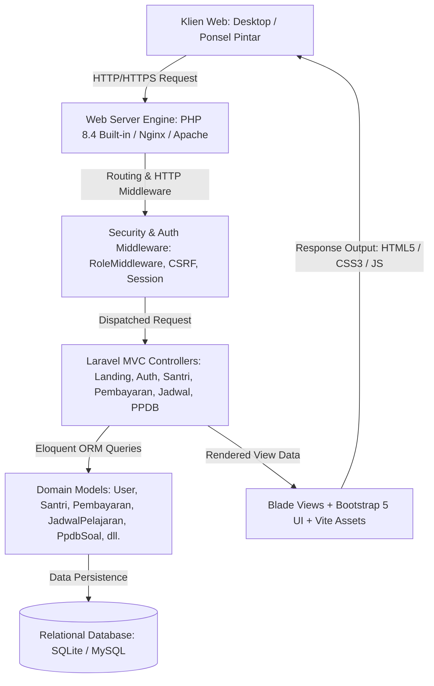
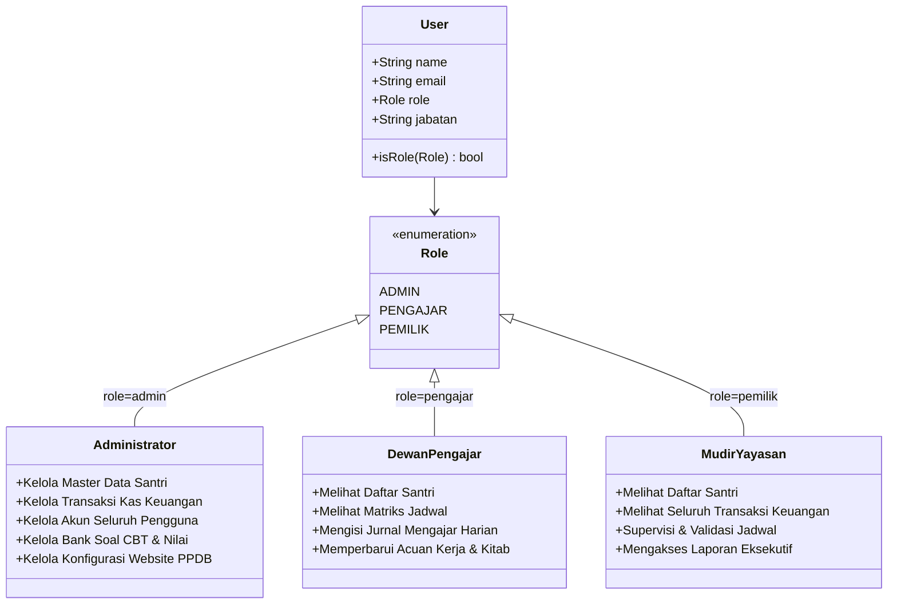
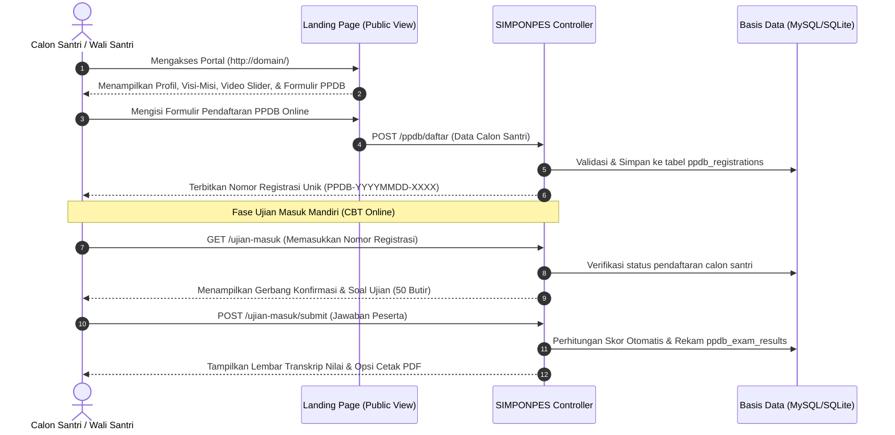
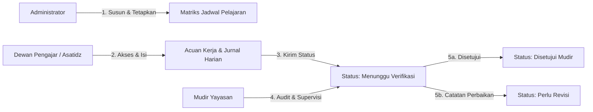
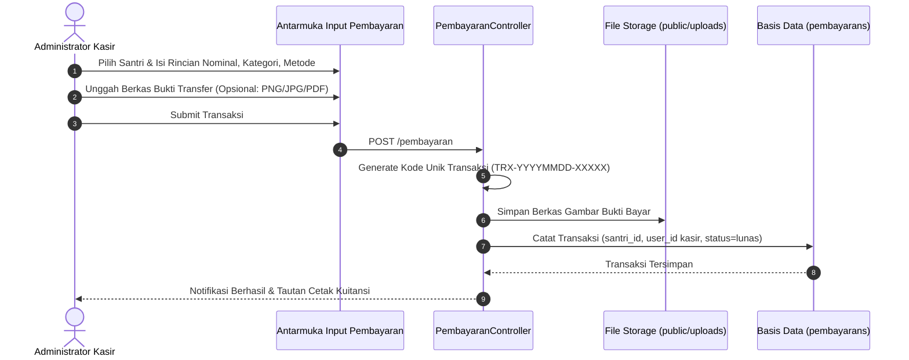

# BUKU PANDUAN PENGGUNA DAN DOKUMENTASI SISTEM (SYSTEM MANUAL BOOK)
## SISTEM INFORMASI MANAJEMEN PONDOK PESANTREN (SIMPONPES)
### YAYASAN ISLAM PONDOK PESANTREN LI ULIL ALBAB PANDEGLANG

---

## IDENTITAS DOKUMEN

| Parameter Dokumen | Keterangan Spesifik |
| :--- | :--- |
| **Judul Dokumen** | Buku Panduan Pengguna dan Dokumentasi Teknis Sistem Informasi Manajemen Pondok Pesantren (SIMPONPES) |
| **Institusi Naungan** | Yayasan Islam Pondok Pesantren Li Ulil Albab Pandeglang |
| **Lingkungan Framework** | Laravel Framework (PHP 8.4 Engine) |
| **Arsitektur Antarmuka** | Blade Templating Engine, Bootstrap 5 UI Framework, Vite Asset Bundler |
| **Basis Data** | Relational Database Management System (MySQL / SQLite Compatible) |
| **Klasifikasi Dokumen** | Buku Panduan Operasional Sistem & Dokumentasi Akademik |
| **Target Pembaca** | Administrator Sistem, Dewan Asatidz / Pengajar, Mudir / Pemilik Yayasan, Panitia PPDB, dan Pengelola Akademik |

---

## KATA PENGANTAR AKADEMIK

Puji dan syukur senantiasa dipanjatkan ke hadirat Allah Subhanahu wa Ta'ala atas limpahan rahmat, taufik, dan hidayah-Nya, sehingga perancangan, implementasi, dan penyusunan **Buku Panduan Pengguna dan Dokumentasi Teknis Sistem Informasi Manajemen Pondok Pesantren (SIMPONPES)** pada Yayasan Islam Pondok Pesantren Li Ulil Albab Pandeglang dapat diselesaikan secara komprehensif dan sistematis.

Transformasi digital dalam tata kelola institusi pendidikan Islam tradisional (pesantren) telah menjadi imperatif strategis di era revolusi industri 4.0 dan era disrupsi informasi. Pesantren modern dituntut tidak hanya menjaga tradisi keilmuan Islam (*tafaqquh fid-din*) dan transmisi nilai-nilai moral luhur, melainkan juga mengadopsi prinsip tata kelola kelembagaan yang transparan, akuntabel, efisien, dan terukur (*good institutional governance*). Integrasi teknologi informasi melalui aplikasi SIMPONPES dirancang secara kontekstual guna menjawab kompleksitas operasional kepesantrenan—mulai dari proses penerimaan santri baru berbasis daring (*Computer-Based Test*), penatausahaan data induk santri, transparansi manajemen keuangan, hingga pengawasan mutu pengajaran terpadu oleh pimpinan pondok (*mudir*).

Buku panduan ini disusun dengan pendekatan analitis dan kaidah penulisan ilmiah-akademis guna menyajikan panduan operasional yang tidak hanya bersifat teknis instrumental, namun juga memberikan pemahaman konseptual mengenai arsitektur logika sistem, matriks kewenangan berbasis peran (*Role-Based Access Control*), serta mitigasi risiko operasional. Diharapkan karya dokumentasi ini dapat menjadi rujukan fundamental bagi segenap pemangku kepentingan (stakeholders) di lingkungan Yayasan Islam Pondok Pesantren Li Ulil Albab Pandeglang dalam mengoptimalkan utilisasi sistem secara berkelanjutan.

Semoga kontribusi ini menjadi amal jariyah keilmuan dan menjadi pijakan bagi inovasi digital pendidikan Islam yang berkelanjutan.

Pandeglang, 2026  
**Tim Pengembang & Pengelola Sistem Informasi**  
*Yayasan Islam Pondok Pesantren Li Ulil Albab Pandeglang*

---

## DAFTAR ISI

- [KATA PENGANTAR AKADEMIK](#kata-pengantar-akademik)
- [DAFTAR ISI](#daftar-isi)
- [BAB I: PENDAHULUAN DAN LANDASAN PENGEMBANGAN SISTEM](#bab-i-pendahuluan-dan-landasan-pengembangan-sistem)
  - [1.1 Latar Belakang dan Konteks Institusional](#11-latar-belakang-dan-konteks-institusional)
  - [1.2 Landasan Teoretis dan Kerangka Konseptual](#12-landasan-teoretis-dan-kerangka-konseptual)
  - [1.3 Maksud, Tujuan, dan Manfaat Sistemik](#13-maksud-tujuan-dan-manfaat-sistemik)
  - [1.4 Ruang Lingkup dan Batasan Operasional](#14-ruang-lingkup-dan-batasan-operasional)
- [BAB II: ARSITEKTUR PERANGKAT LUNAK DAN SPESIFIKASI TEKNIS](#bab-ii-arsitektur-perangkat-lunak-dan-spesifikasi-teknis)
  - [2.1 Pola Perancangan Model-View-Controller (MVC)](#21-pola-perancangan-model-view-controller-mvc)
  - [2.2 Tumpukan Teknologi (Technology Stack) dan Lingkungan Komputasi](#22-tumpukan-teknologi-technology-stack-dan-lingkungan-komputasi)
  - [2.3 Skema Basis Data Relasional dan Integritas Entitas](#23-skema-basis-data-relasional-dan-integritas-entitas)
  - [2.4 Kerangka Keamanan dan Pertahanan Sistem](#24-kerangka-keamanan-dan-pertahanan-sistem)
- [BAB III: KERANGKA OTORISASI DAN ROLE-BASED ACCESS CONTROL (RBAC)](#bab-iii-kerangka-otorisasi-dan-role-based-access-control-rbac)
  - [3.1 Konsep Role-Based Access Control (RBAC) pada SIMPONPES](#31-konsep-role-based-access-control-rbac-pada-simponpes)
  - [3.2 Klasifikasi Profil dan Hak Istimewa Pengguna](#32-klasifikasi-profil-dan-hak-istimewa-pengguna)
  - [3.3 Matriks Otorisasi Fungsional Antarperan](#33-matriks-otorisasi-fungsional-antarperan)
- [BAB IV: MODUL GERBANG PUBLIK DAN PPDB ONLINE](#bab-iv-modul-gerbang-publik-dan-ppdb-online)
  - [4.1 Portal Komunikasi Publik (Landing Page) Dinamis](#41-portal-komunikasi-publik-landing-page-dinamis)
  - [4.2 Prosedur Pendaftaran Penerimaan Peserta Didik Baru (PPDB)](#42-prosedur-pendaftaran-penerimaan-peserta-didik-baru-ppdb)
  - [4.3 Subsistem Ujian Masuk Mandiri Berbasis Komputer (Computer-Based Test / CBT)](#43-subsistem-ujian-masuk-mandiri-berbasis-komputer-computer-based-test--cbt)
  - [4.4 Algoritma Penilaian, Transkrip Skor, dan Penerbitan Hasil Evaluasi](#44-algoritma-penilaian-transkrip-skor-dan-penerbitan-hasil-evaluasi)
- [BAB V: MODUL TATA KELOLA AKADEMIK DAN MASTER DATA SANTRI](#bab-v-modul-tata-kelola-akademik-dan-master-data-santri)
  - [5.1 Penatausahaan Data Induk Santri (Student Master Record)](#51-penatausahaan-data-induk-santri-student-master-record)
  - [5.2 Manajemen Pengelompokan Kelas dan Penempatan Asrama/Kamar](#52-manajemen-pengelompokan-kelas-dan-penempatan-asramakamar)
  - [5.3 Mekanisme Penelusuran Terindeks dan Penyaringan Data](#53-mekanisme-penelusuran-terindeks-dan-penyaringan-data)
- [BAB VI: MODUL KURIKULUM, JADWAL PEMBELAJARAN, DAN SUPERVISI MUTU](#bab-vi-modul-kurikulum-jadwal-pembelajaran-dan-supervisi-mutu)
  - [6.1 Strukturisasi Matriks Jadwal Pembelajaran](#61-strukturisasi-matriks-jadwal-pembelajaran)
  - [6.2 Manajemen Acuan Kerja Akademik (Silabus, Kitab Rujukan, Target Capaian)](#62-manajemen-acuan-kerja-akademik-silabus-kitab-rujukan-target-capaian)
  - [6.3 Presensi dan Rekam Jejak Jurnal Perkuliahan Harian](#63-presensi-dan-rekam-jejak-jurnal-perkuliahan-harian)
  - [6.4 Protokol Supervisi Mutu Instruksional oleh Mudir Yayasan](#64-protokol-supervisi-mutu-instruksional-oleh-mudir-yayasan)
  - [6.5 Pencetakan Dokumen Jadwal Akademik Terpadu](#65-pencetakan-dokumen-jadwal-akademik-terpadu)
- [BAB VII: MODUL ADMINISTRASI KEUANGAN DAN TRANSAKSI KAS](#bab-vii-modul-administrasi-keuangan-dan-transaksi-kas)
  - [7.1 Taksonomi Pos Pembayaran dan Struktur Tarif](#71-taksonomi-pos-pembayaran-dan-struktur-tarif)
  - [7.2 Prosedur Pencatatan dan Validasi Bukti Pembayaran](#72-prosedur-pencatatan-dan-validasi-bukti-pembayaran)
  - [7.3 Penerapan Prinsip Pemisahan Tugas (Segregation of Duties)](#73-penerapan-prinsip-pemisahan-tugas-segregation-of-duties)
  - [7.4 Pencetakan Lembar Kuitansi dan Validasi Transaksi Resmi](#74-pencetakan-lembar-kuitansi-dan-validasi-transaksi-resmi)
- [BAB VIII: MODUL MANAJEMEN KONTEN, MULTIMEDIA, DAN KONFIGURASI SISTEM](#bab-viii-modul-manajemen-konten-multimedia-dan-konfigurasi-sistem)
  - [8.1 Kurasi Dokumentasi Berita dan Galeri Kegiatan Pesantren](#81-kurasi-dokumentasi-berita-dan-galeri-kegiatan-pesantren)
  - [8.2 Publikasi Media Audio-Visual dan Konfigurasi Hero Video Slider](#82-publikasi-media-audio-visual-dan-konfigurasi-hero-video-slider)
  - [8.3 Konfigurasi Metadata Institusi dan Parameter Gelombang PPDB](#83-konfigurasi-metadata-institusi-dan-parameter-gelombang-ppdb)
  - [8.4 Tata Kelola Bank Soal Seleksi Masuk PPDB](#84-tata-kelola-bank-soal-seleksi-masuk-ppdb)
- [BAB IX: MODUL PELAPORAN EKSEKUTIF DAN AUDITABILITAS SISTEM](#bab-ix-modul-pelaporan-eksekutif-dan-auditabilitas-sistem)
  - [9.1 Dasbor Analitik Eksekutif dan Visualisasi Demografi Santri](#91-dasbor-analitik-eksekutif-dan-visualisasi-demografi-santri)
  - [9.2 Laporan Rekapitulasi Komprehensif Kesiswaan untuk Pimpinan](#92-laporan-rekapitulasi-komprehensif-kesiswaan-untuk-pimpinan)
  - [9.3 Manajemen Pengguna dan Akuntabilitas Rekam Jejak Sistem](#93-manajemen-pengguna-dan-akuntabilitas-rekam-jejak-sistem)
- [BAB X: STANDAR OPERASIONAL PROSEDUR (SOP) DAN PANDUAN PEMECAHAN MASALAH](#bab-x-standar-operasional-prosedur-sop-dan-panduan-pemecahan-masalah)
  - [10.1 Prosedur Operasional Baku (SOP) Berdasarkan Entitas Pengguna](#101-prosedur-operasional-baku-sop-berdasarkan-entitas-pengguna)
  - [10.2 Manajemen Insiden dan Pemecahan Masalah Teknis (Troubleshooting)](#102-manajemen-insiden-dan-pemecahan-masalah-teknis-troubleshooting)
  - [10.3 Protokol Pemulihan Akses Kredensial (Password Reset Workflow)](#103-protokol-pemulihan-akses-kredensial-password-reset-workflow)
  - [10.4 Pemeliharaan Berkala dan Strategi Pencadangan Basis Data (Backup)](#104-pemeliharaan-berkala-dan-strategi-pencadangan-basis-data-backup)
- [BAB XI: KESIMPULAN DAN REKOMENDASI PENGEMBANGAN](#bab-xi-kesimpulan-dan-rekomendasi-pengembangan)
  - [11.1 Kesimpulan Implementasi](#111-kesimpulan-implementasi)
  - [11.2 Rekomendasi Peningkatan Kapabilitas Sistem](#112-rekomendasi-peningkatan-kapabilitas-sistem)

---

## BAB I: PENDAHULUAN DAN LANDASAN PENGEMBANGAN SISTEM

### 1.1 Latar Belakang dan Konteks Institusional
Pondok pesantren merupakan lembaga pendidikan Islam bercorak khas Indonesia yang memegang peranan krusial dalam pembentukan karakter keagamaan (*tafaqquh fid-din*), keilmuan, dan kemandirian moral bangsa. Yayasan Islam Pondok Pesantren Li Ulil Albab Pandeglang sebagai institusi pendidikan berbasis asrama (*boarding school*) menyelenggarakan tata bina keilmuan Islam integratif, memadukan kurikulum salafiyah kitab kuning dengan pendidikan formal modern.

Pertumbuhan kuantitas santri, keragaman latar belakang geografis calon santri, serta tuntutan akuntabilitas kelembagaan dari para wali santri dan masyarakat menuntut adanya modernisasi instrumen manajemen institusional. Pola tata kelola konvensional berbasis pencatatan manual (*paper-based documentation*) rentan terhadap berbagai anomali manajerial, antara lain redundansi data, fragmentasi informasi keuangan, lambatnya rekapitulasi kehadiran akademik, serta keterbatasan aksesibilitas publik terhadap informasi resmi pesantren.

Oleh karena itu, diinisiasi perancangan dan implementasi **Sistem Informasi Manajemen Pondok Pesantren (SIMPONPES)**. Aplikasi ini dirancang sebagai platform terpadu (*integrated web-based platform*) untuk mendigitalisasi, mengotomatisasi, dan mengonsolidasi seluruh spektrum operasional lembaga, mulai dari penerimaan santri baru, monitoring kurikulum pengajaran, manajemen transaksi keuangan santri, hingga pelaporan berkala bagi jajaran pengambil keputusan tingkat tinggi (*executive leadership*).

### 1.2 Landasan Teoretis dan Kerangka Konseptual
Sistem Informasi Manajemen (SIM) dalam literatur ilmu komputer dan manajemen pendidikan didefinisikan sebagai sistem sosio-teknikal yang mengolah data mentah menjadi informasi terstruktur guna mendukung fungsi operasional, manajerial, dan pengambilan keputusan strategis (*strategic decision-making*). Pengembangan SIMPONPES berpijak pada sejumlah postulat teoretis:

1. **Teori Integrasi Data (*Data Integration Theory*)**: Seluruh entitas kelembagaan—santri, asatidz, mata pelajaran, transaksi keuangan, dan hasil ujian seleksi—diorganisasikan dalam satu repositori data terpadu untuk mengeliminasi inkonsistensi data antarunit kerja.
2. **Prinsip Tata Kelola Kelembagaan yang Baik (*Good Institutional Governance*)**: Menegakkan pilar transparansi (*transparency*), akuntabilitas (*accountability*), responsibilitas (*responsibility*), independensi (*independency*), dan kewajaran (*fairness*) pada setiap alur transaksi dan evaluasi akademik.
3. **Pemisahan Kewenangan (*Segregation of Duties*)**: Menghindarkan konsentrasi kekuasaan atau benturan kepentingan dengan membatasi interaksi antarmuka sesuai ranah tanggung jawab struktural, seperti pemisahan wewenang dewan pengajar dari wewenang pengelolaan keuangan kas santri.

### 1.3 Maksud, Tujuan, dan Manfaat Sistemik
Penyusunan instrumen SIMPONPES memiliki maksud dan tujuan strategis sebagai berikut:

- **Maksud**: Mewujudkan infrastruktur digital tata kelola pendidikan dan administrasi kepesantrenan yang terstandardisasi, aman, dan mudah diakses oleh segenap sivitas akademika Yayasan Islam Pondok Pesantren Li Ulil Albab Pandeglang.
- **Tujuan Operasional**:
  1. Menyediakan gerbang pendaftaran santri baru berbasis daring (*PPDB Online*) yang dilengkapi dengan modul seleksi akademik mandiri (*Computer-Based Test / CBT*) berskala seketika (*real-time scoring*).
  2. Menyediakan modul administrasi kesiswaan terintegrasi untuk pencatatan riwayat santri, identitas wali, alokasi kelas, dan sebaran kamar asrama.
  3. Membangun modul manajemen kurikulum pembelajaran yang memfasilitasi pencatatan jurnal halaqah dan supervisi pengajaran langsung oleh Mudir Yayasan.
  4. Menyelenggarakan pencatatan keuangan pesantren yang tertib, akuntabel, dan transparan, disertai penerbitan kuitansi transaksi yang sah.
  5. Menyediakan portal publik informatif yang menyajikan visi, misi, profil, dokumentasi kegiatan, serta media visual interaktif pesantren secara aktual.
- **Manfaat Sistemik**:
  - Efisiensi waktu pengolahan data kesiswaan dan pendaftaran santri hingga 70%.
  - Peningkatan akurasi kalkulasi keuangan dan pencegahan kebocoran anggaran kas pesantren.
  - Peningkatan reputasi dan jangkauan syiar lembaga di tingkat regional maupun nasional.

### 1.4 Ruang Lingkup dan Batasan Operasional
Dokumentasi dan manual book ini mencakup seluruh fungsionalitas aplikasi SIMPONPES yang diimplementasikan pada peladen (*server*) lokal maupun komputasi awan. Batasan operasional sistem meliputi:
- Sistem beroperasi pada arsitektur web modern yang dapat diakses melalui peramban web (*web browser*) berbasis desktop maupun perangkat bergerak (*mobile responsive*).
- Otorisasi administratif dibagi ke dalam tiga peran formal dalam sistem: **Administrator**, **Dewan Pengajar / Asatidz**, dan **Pemilik / Mudir Yayasan**, di samping peran eksternal untuk **Calon Santri / Wali Santri**.
- Lingkup transaksi keuangan mencakup pencatatan pembayaran internal (SPP, uang pangkal, gedung, pendaftaran, dan infaq) beserta verifikasi bukti transfer perbankan atau pembayaran tunai (*cash*).

---

## BAB II: ARSITEKTUR PERANGKAT LUNAK DAN SPESIFIKASI TEKNIS

### 2.1 Pola Perancangan Model-View-Controller (MVC)
SIMPONPES diimplementasikan dengan mengadopsi pola arsitektur **Model-View-Controller (MVC)** yang memisahkan logika domain bisnis, lapisan representasi antarmuka, dan kendali aliran data:
1. **Model Layer (`app/Models`)**: Merepresentasikan struktur entitas data dan aturan bisnis (*business logic rules*). Model menggunakan *Eloquent Object-Relational Mapping (ORM)* untuk mengabstraksi komunikasi dengan basis data relasional.
2. **View Layer (`resources/views`)**: Mengelola presentasi visual menggunakan *Blade Templating Engine*. View disusun secara modular dengan tata letak utama (*layout master*), komponen formulir, tabel dinamis, dan dialog modal berbasis Bootstrap 5.
3. **Controller Layer (`app/Http/Controllers`)**: Bertindak sebagai orkestrator yang menerima permintaan HTTP (*HTTP Request*), melakukan validasi masukan data, berinteraksi dengan Model, dan mengirimkan hasil olahan data ke View yang relevan.

### 2.2 Tumpukan Teknologi (Technology Stack) dan Lingkungan Komputasi
Aplikasi SIMPONPES dibangun di atas tumpukan teknologi modern berstandar enterprise:

| Komponen Teknologi | Spesifikasi / Versi | Peran dan Fungsi dalam Ekosistem |
| :--- | :--- | :--- |
| **Bahasa Pemrograman** | PHP 8.4 (Engine Native) | Menjalankan seluruh logika komputasi backend, type-safety, dan eksekusi skrip server. |
| **Framework Backend** | Laravel Framework | Menyediakan routing, dependency injection, middleware security, ORM, dan modul autentikasi. |
| **Antarmuka Pengguna** | Bootstrap 5 & Custom CSS | Menyediakan komponen tata letak responsif, grid system, dan komponen interaktif antarmuka. |
| **Asset Pipeline** | Vite Bundler | Kompilasi modul JavaScript modern, optimasi stylesheet CSS, dan manajemen pustaka frontend. |
| **Ikonografi & Desain** | Bootstrap Icons & FontAwesome | Representasi visual intuitif untuk navigasi dan penanda aksi operasional. |
| **Penyimpanan Data** | SQLite Engine / MySQL RDBMS | Penyimpanan persisten untuk integritas data transaksional dan tabel-tabel relasional. |

### 2.3 Skema Basis Data Relasional dan Integritas Entitas
Basis data SIMPONPES dirancang menggunakan prinsip normalisasi relasional guna mencegah anomali insersi, pembaruan, dan penghapusan data. Entitas utama dalam skema basis data meliputi:

1. **`users`**: Menyimpan identitas akun pengguna internal dengan atribut `name`, `email`, `password` (terenkripsi *Bcrypt/Argon2*), `role` (enum: `admin`, `pengajar`, `pemilik`), `jabatan`, dan nomor kontak.
2. **`santris`**: Menyimpan master data peserta didik, memuat Nomor Induk Santri (`nis`), `nama_lengkap`, `jenis_kelamin`, demografi kelahiran, `kamar`, `kelas`, dan data wali.
3. **`pembayarans`**: Menyimpan transaksi kas masuk dengan atribut relasional `santri_id` (foreign key ke `santris`), `user_id` (foreign key pencatat transaksi ke `users`), `kode_transaksi`, `kategori_pembayaran`, nominal `jumlah`, `metode_pembayaran`, serta unggahan berkas `bukti_bayar`.
4. **`jadwal_pelajarans`**: Menyimpan struktur kurikulum pembelajaran harian dengan foreign key `user_id` (sebagai pengajar) dan `supervisi_by` (sebagai peninjau mutu/Mudir), status pelaksanaan, dan jurnal materi.
5. **`ppdb_registrations`**: Menyimpan berkas pendaftaran calon santri baru secara daring beserta kode pendaftaran unik, identitas wali, dan preferensi jenjang.
6. **`ppdb_soals` & `ppdb_exam_results`**: Menyimpan bank butir soal pilihan ganda beserta kunci jawaban dan hasil evaluasi Computer-Based Test (CBT) calon santri.
7. **`ppdb_settings`**: Menyimpan konfigurasi kelembagaan dinamis (nama pesantren, visi, misi, pilar keunggulan, struktur yayasan, kuota, dan jadwal seleksi).
8. **`kegiatans` & `videos`**: Repositori konten multimedia untuk publikasi warta pesantren, foto kegiatan, dan video profil kelembagaan.

### 2.4 Kerangka Keamanan dan Pertahanan Sistem
SIMPONPES menerapkan paradigma *Defense-in-Depth* untuk memastikan keamanan data kelembagaan:
- **Proteksi Cross-Site Request Forgery (CSRF)**: Setiap formulir pengiriman data (`POST`, `PUT`, `DELETE`) dilindungi oleh token kriptografis unik yang divalidasi oleh `VerifyCsrfToken` middleware.
- **Pencegahan SQL Injection**: Seluruh pertukaran data dengan basis data memanfaatkan mekanisme *Prepared Statements* dan *Parameter Binding* melalui Eloquent ORM.
- **Sanitasi Masukan dan Pencegahan XSS**: Karakter berbahaya pada antarmuka disanitasi secara otomatis oleh sintaks kurung kurawal ganda Blade (`{{ $data }}`).
- **Enkripsi Kredensial**: Seluruh kata sandi pengguna disimpan menggunakan fungsi *hashing* satu arah (*one-way salted hash*) standar industri.
- **Pembatasan Laju Akses (*Rate Limiting*)**: Mencegah upaya serangan *brute force* pada formulir autentikasi masuk.

---

## BAB III: KERANGKA OTORISASI DAN ROLE-BASED ACCESS CONTROL (RBAC)

### 3.1 Konsep Role-Based Access Control (RBAC) pada SIMPONPES
Pengelolaan hak akses pada SIMPONPES mengadopsi standar **Role-Based Access Control (RBAC)**. Dalam paradigma ini, hak istimewa operasional (*privileges*) tidak dilekatkan secara acak pada individu pengguna, melainkan diasosiasikan secara ketat pada peran fungsional (*role*) yang diemban dalam struktur tata kelola Yayasan Islam Pondok Pesantren Li Ulil Albab Pandeglang.

Mekanisme RBAC dieksekusi pada tingkat perutean (*routing middleware*) melalui modul `RoleMiddleware` dan `EnsureRole`. Setiap permintaan akses diperiksa secara berlapis:
1. Verifikasi Status Autentikasi (`auth` middleware).
2. Verifikasi Kesesuaian Peran Aktif (`role:{nama_role}` middleware).
3. Penolakan terotorisasi secara otomatis (*HTTP 403 Forbidden*) apabila pengguna mencoba mengakses modul di luar yurisdiksi perannya.

### 3.2 Klasifikasi Profil dan Hak Istimewa Pengguna

#### 3.2.1 Administrator Sistem (`admin`)
- **Fungsi Struktural**: Bertindak sebagai administrator teknis dan tata usaha institusi.
- **Karakteristik Otorisasi**: Memiliki hak akses penuh (*Full Administrative Privileges*) terhadap seluruh modul master data, transaksi keuangan, penambahan/penghapusan akun, konfigurasi konten media, dan bank soal ujian masuk.

#### 3.2.2 Dewan Pengajar / Asatidz (`pengajar`)
- **Fungsi Struktural**: Bertindak sebagai pengampu mata pelajaran, pembimbing halaqah santri, dan pelaksana teknis kurikulum.
- **Karakteristik Otorisasi**: Diberikan hak akses membaca data kesiswaan dan jadwal, serta hak menulis jurnal mengajar pribadi. Demi menegakkan prinsip pemisahan tugas, **Dewan Pengajar secara mutlak tidak memiliki hak akses terhadap transaksi keuangan kas pesantren**.

#### 3.2.3 Pemilik / Mudir Yayasan (`pemilik`)
- **Fungsi Struktural**: Pimpinan tertinggi yayasan pesantren yang bertanggung jawab atas arah kebijakan, penjaminan mutu pendidikan, dan pengawasan manajerial.
- **Karakteristik Otorisasi**: Memiliki hak pemantauan komprehensif (*Read-All Privileges*), hak supervisi instruksional (menyetujui atau meminta revisi jurnal mengajar asatidz), verifikasi kas keuangan santri, serta akses eksklusif terhadap Laporan Eksekutif Kesiswaan.

#### 3.2.4 Pengguna Publik / Calon Santri (`guest`)
- **Fungsi Struktural**: Masyarakat umum, wali calon santri, dan peserta pendaftaran baru.
- **Karakteristik Otorisasi**: Mengakses landing page, formulir PPDB online, modul pengerjaan ujian masuk (CBT), serta pencetakan bukti pendaftaran dan hasil ujian tanpa memerlukan akun login sistem.

### 3.3 Matriks Otorisasi Fungsional Antarperan

| Modul Fungsional SIMPONPES | Aksi / Rute Sistem | Admin | Pengajar | Pemilik/Mudir | Publik/Calon Santri |
| :--- | :--- | :---: | :---: | :---: | :---: |
| **Landing Page & Informasi** | `GET /` | Akses | Akses | Akses | Akses |
| **Pendaftaran PPDB Online** | `POST /ppdb/daftar` | Akses | Akses | Akses | Akses |
| **Ujian CBT Mandiri** | `GET,POST /ujian-masuk/*` | Akses | Akses | Akses | Akses |
| **Dasbor Utama (Dashboard)** | `GET /dashboard` | Penuh | Terbatas | Eksekutif | Ditolak (403) |
| **Data Induk Santri (View)** | `GET /santri`, `GET /santri/{id}` | Penuh | Akses Baca | Akses Baca | Ditolak (403) |
| **Data Induk Santri (CRUD)** | `POST,PUT,DELETE /santri/*` | Ya (Penuh) | Ditolak (403) | Ditolak (403) | Ditolak (403) |
| **Jadwal Pelajaran (View)** | `GET /jadwal`, `GET /jadwal/{id}` | Akses | Akses | Akses | Ditolak (403) |
| **Jadwal Pelajaran (CRUD)** | `POST,PUT,DELETE /jadwal/*` | Ya (Penuh) | Ditolak (403) | Ditolak (403) | Ditolak (403) |
| **Jurnal & Acuan Pelajaran** | `POST /jadwal/{id}/acuan` | Ya | Milik Sendiri | Ya | Ditolak (403) |
| **Supervisi Jadwal Pengajar** | `POST /jadwal/{id}/supervisi` | Ya | Ditolak (403) | Ya (Wewenang) | Ditolak (403) |
| **Transaksi Keuangan (View)**| `GET /pembayaran`, `GET /pembayaran/{id}` | Ya | **Ditolak (403)** | Ya (Audit) | Ditolak (403) |
| **Transaksi Keuangan (CRUD)**| `POST,PUT,DELETE /pembayaran/*` | Ya (Penuh) | **Ditolak (403)** | Ditolak (403) | Ditolak (403) |
| **Manajemen Pengguna (User)** | `GET,POST,PUT,DELETE /users/*` | Ya (Penuh) | Ditolak (403) | Ditolak (403) | Ditolak (403) |
| **Bank Soal & Nilai PPDB** | `GET,POST,PUT,DELETE /admin/ppdb/*` | Ya (Penuh) | Ditolak (403) | Ditolak (403) | Ditolak (403) |
| **Pengaturan Website PPDB** | `GET,PUT /admin/ppdb-setting` | Ya (Penuh) | Ditolak (403) | Ditolak (403) | Ditolak (403) |
| **Galeri Warta & Video** | `Resource /kegiatan`, `/video` | Ya (Penuh) | Ditolak (403) | Ditolak (403) | Ditolak (403) |
| **Laporan Eksekutif Kesiswaan**| `GET /laporan/santri` | Akses | Ditolak (403) | Akses Utama | Ditolak (403) |

---

## BAB IV: MODUL GERBANG PUBLIK DAN PPDB ONLINE

### 4.1 Portal Komunikasi Publik (Landing Page) Dinamis
Halaman beranda publik dirancang sebagai etalase digital resmi lembaga. Modul ini secara dinamis menyajikan:
- **Hero Banner dan Video Slider**: Menampilkan 4 video representatif pilihan administrator (`is_hero_slider = true`) dengan deskripsi ringkas dan tautan pemutar video interaktif.
- **Statistik Dinamis Real-Time**: Agregasi data langsung dari basis data, mencakup jumlah santri aktif, jumlah dewan asatidz terdaftar, total pendaftar PPDB, serta sisa kuota penerimaan tahun ajaran berjalan.
- **Profil dan Landasan Filosofis**: Memuat sejarah singkat, filosofi penamaan Li Ulil Albab, sambutan Mudir Yayasan, visi-misi, serta pilar-pilar keunggulan kurikulum pesantren.
- **Dokumentasi Warta dan Galeri**: Menyajikan dokumentasi kegiatan akademik dan ekstrakurikuler santri terkini.

### 4.2 Prosedur Pendaftaran Penerimaan Peserta Didik Baru (PPDB)
Calon santri atau wali santri dapat melakukan registrasi tanpa hambatan geografis melalui formulir elektronik dengan alur kerja berikut:
1. Pengguna membuka bagian formulir pada portal (`#formulir-ppdb`).
2. Pengguna melengkapi atribut data wajib:
   - Identitas Calon Santri: Nama Lengkap, Jenis Kelamin, Tempat Lahir, Tanggal Lahir, NISN (opsional), Asal Sekolah, Jenjang Pendidikan (SMP / MTs / SMA / MA / Takhasus).
   - Identitas Wali: Nama Wali, Nomor WhatsApp Aktif (untuk koordinasi panitia), Pekerjaan, dan Pendidikan Wali.
   - Domisili dan Jalur: Alamat Lengkap, Jalur Pendaftaran (Reguler, Prestasi, Afirmasi), Model Ujian (Online CBT / Tatap Muka), dan Catatan Prestasi jika ada.
3. Sistem melakukan validasi ketat terhadap integritas tipe data dan keunikan masukan.
4. Setelah data tersimpan, sistem secara otomatis men-generate **Nomor Registrasi Unik** dengan format berstandar ISO:
   $$\text{Format Nomor Registrasi} = \text{PPDB-YYYYMMDD-XXXX}$$
5. Pengguna diarahkan ke lembar konfirmasi yang memuat nomor registrasi dan instruksi melanjutkan ke tahapan Computer-Based Test (CBT).

### 4.3 Subsistem Ujian Masuk Mandiri Berbasis Komputer (Computer-Based Test / CBT)
SIMPONPES dilengkapi modul seleksi mandiri terkomputerisasi (`/ujian-masuk`) guna memastikan seleksi penerimaan santri berjalan objektif, transparan, dan terukur:
1. **Otorisasi Sesi Ujian**: Calon santri memasukkan Nomor Registrasi pendaftaran yang sah. Sistem memvalidasi eksistensi berkas pendaftaran dan memastikan calon santri belum pernah menyelesaikan sesi ujian sebelumnya.
2. **Penyajian Soal Dinamis**: Sistem mengambil seluruh butir soal aktif (`is_aktif = true`) dari tabel `ppdb_soals`, mencakup materi Pendidikan Agama Islam, Bahasa Arab Dasar, Membaca Al-Qur'an/Tajwid, dan Potensi Akademik Umum.
3. **Penyelesaian Ujian**: Antarmuka ujian dilengkapi fitur pemilihan jawaban pilihan ganda (opsi A hingga D) serta indikator keterisian butir soal.

### 4.4 Algoritma Penilaian, Transkrip Skor, dan Penerbitan Hasil Evaluasi
Ketika lembar jawaban dikirimkan (`POST /ujian-masuk/submit`), mesin evaluasi sistem menjalankan kalkulasi matematis seketika:

$$\text{Nilai Akhir} = \left( \frac{\sum \text{Bobot Jawaban Benar}}{\sum \text{Total Bobot Maksimal Soal Aktif}} \right) \times 100$$

- **Perekaman Rekam Jejak**: Jawaban tiap butir soal, jumlah jawaban benar, jawaban salah, jawaban kosong, nilai akhir, serta durasi pengerjaan direkam ke dalam tabel `ppdb_exam_results`.
- **Penentuan Status Awal**: Sistem memberikan predikat kelulusan otomatis berdasarkan passing grade yang dikonfigurasi (*Lulus*, *Dipertimbangkan*, atau *Tidak Lulus*), yang selanjutnya dapat dianotasi oleh Administrator atau Penguji Wawancara.
- **Penerbitan Bukti Kelulusan**: Santri dapat langsung mengunduh atau mencetak **Lembar Transkrip Hasil Ujian Resmi** yang memuat barcode/informasi keabsahan data untuk dibawa saat daftar ulang fisik.

---

## BAB V: MODUL TATA KELOLA AKADEMIK DAN MASTER DATA SANTRI

### 5.1 Penatausahaan Data Induk Santri (Student Master Record)
Pencatatan data induk santri (`/santri`) merupakan inti dari tata kelola operasional SIMPONPES. Setiap entitas santri memuat atribut komprehensif:

| Nama Atribut | Tipe Data | Definisi Operasional dan Kaidah Validasi |
| :--- | :--- | :--- |
| `nis` | Varchar (Unique) | Nomor Induk Santri resmi yang diterbitkan yayasan; bersifat unik dan menjadi kunci pencarian primer. |
| `nama_lengkap` | Varchar (255) | Nama lengkap santri sesuai akta kelahiran/ijazah jenjang sebelumnya. |
| `jenis_kelamin` | Enum | Klasifikasi gender santri: `Laki-laki` (Santriwan) atau `Perempuan` (Santriwati). |
| `tempat_lahir` | Varchar (100) | Kota/Kabupaten tempat kelahiran santri. |
| `tanggal_lahir` | Date | Tanggal lahir valid; digunakan untuk kalkulasi otomatis atribut usia (`usia`). |
| `nama_orang_tua` | Varchar (255) | Nama lengkap ayah/ibu kandung atau wali santri yang bertanggung jawab secara hukum. |
| `no_hp` | Varchar (30) | Nomor telepon/WhatsApp aktif orang tua untuk diseminasi warta dan kuitansi pembayaran. |
| `kamar` | Varchar (100) | Penamaan bilik asrama hunian santri (misal: "Kamar Abu Bakar", "Kamar Khadijah 1"). |
| `kelas` | Varchar (50) | Tingkatan kelas aktif santri dalam penjenjangan kurikulum pesantren. |
| `alamat` | Text | Domisili asal keluarga santri secara lengkap. |

### 5.2 Manajemen Pengelompokan Kelas dan Penempatan Asrama/Kamar
Aplikasi mendukung klasifikasi multidimensi guna menunjang pelaporan demografis dan penegakan tata tertib pesantren:
- **Pengelompokan Kelas**: Mengelompokkan santri berdasarkan jenjang kurikulum formal dan diniyah. Hal ini memudahkan sinkronisasi jadwal mata pelajaran dan penyusunan buku presensi.
- **Alokasi Asrama/Kamar**: Menata distribusi hunian santri guna memastikan kapasitas ruang tidak melebihi ambang batas (*overcapacity*) serta memisahkan area asrama putra dan asrama putri secara ketat.

### 5.3 Mekanisme Penelusuran Terindeks dan Penyaringan Data
Guna memfasilitasi pencarian cepat di antara ribuan catatan santri, antarmuka indeks santri dilengkapi dengan algoritma penyaringan multikriteria (*multi-criteria filtering*):
1. **Pencarian Bebas (*Full-Text Query*)**: Mencocokkan kata kunci terhadap `nama_lengkap`, `nis`, maupun `tempat_lahir`.
2. **Filter Kategorikal**: Penyaringan spesifik berdasarkan parameter `kelas`, `kamar`, dan `jenis_kelamin`.
3. **Paginasi Dinamis (*Stateful Pagination*)**: Pembagian hasil pencarian ke dalam fraksi 10 data per halaman dengan mempertahankan query string pencarian pada tautan halaman berikutnya.

---

## BAB VI: MODUL KURIKULUM, JADWAL PEMBELAJARAN, DAN SUPERVISI MUTU

### 6.1 Strukturisasi Matriks Jadwal Pembelajaran
Modul Jadwal Pelajaran (`/jadwal`) menyajikan jadwal instruksional terpadu yang memetakan relasi antara hari pelaksanaan, rentang jam belajar, ruangan, mata pelajaran/kitab, dan pengajar yang bertugas.
- **Urutan Hari Alamiah**: Pengurutan jadwal diatur secara algoritmik dari hari *Senin* hingga *Ahad* dengan query SQL:
  $$\text{CASE hari WHEN 'Senin' THEN 1 WHEN 'Selasa' THEN 2 ... WHEN 'Ahad' THEN 7 END}$$
- **Informasi Jam Pelajaran**: Memuat pencatatan waktu mulai (`jam_mulai`) hingga waktu berakhir (`jam_selesai`) guna mencegah tumpang tindih penggunaan ruangan (*classroom conflict*).

### 6.2 Manajemen Acuan Kerja Akademik (Silabus, Kitab Rujukan, Target Capaian)
Berbeda dari sistem jadwal konvensional, SIMPONPES mengintegrasikan rencana pembelajaran semester (RPS) langsung ke dalam setiap butir jadwal:
- **Kitab Referensi**: Rujukan pustaka primer atau literatur turats Islam yang wajib dikaji pada mata pelajaran bersangkutan.
- **Target Capaian**: Sasaran kompetensi minimal santri, seperti batas hafalan matan, pemahaman kaidah nahwu-sharaf, atau ketuntasan juz Al-Qur'an.
- **Silabus Ringkas**: Peta alur pembahasan bab per bab sepanjang tahun ajaran aktif.

### 6.3 Presensi dan Rekam Jejak Jurnal Perkuliahan Harian
Dewan Asatidz diwajibkan melakukan pembaruan berkala terhadap materi yang telah diajarkan melalui antarmuka rekam jurnal (`POST /jadwal/{id}/jurnal`):
- Perekaman materi pokok bahasan pertemuan terkini.
- Pembaruan status pelaksanaan pembelajaran (`aktif`, `tuntas`, atau `terkendala`).
- Pencatatan stempel waktu otomatis (`jurnal_updated_at`) untuk verifikasi kedisiplinan administratif pengajar.

### 6.4 Protokol Supervisi Mutu Instruksional oleh Mudir Yayasan
Untuk menjamin mutu pendidikan sesuai standar Yayasan Islam Pondok Pesantren Li Ulil Albab, Mudir memiliki panel kendali mutu instruksional langsung (`POST /jadwal/{id}/supervisi`):
- **Instrumen Audit**: Mudir meninjau kesesuaian antara silabus rencana dengan jurnal materi riil yang ditulis oleh pengajar.
- **Status Verifikasi Tripartit**:
  1. `menunggu_verifikasi`: Keadaan default setelah asatidz memperbarui jurnal materi.
  2. `disetujui_mudir`: Validasi penuh pimpinan atas ketuntasan dan kualitas pengajaran.
  3. `perlu_revisi`: Pengembalian berkas disertai catatan instruktif perbaikan dari Mudir.
- **Audit Identitas**: Rekaman mencatat ID Mudir yang mensupervisi (`supervisi_by`) dan stempel waktu supervisi (`supervisi_at`).

### 6.5 Pencetakan Dokumen Jadwal Akademik Terpadu
Sistem menyediakan antarmuka cetak siap cetak (*print-ready view*) pada rute `/jadwal/cetak` yang memformat seluruh jadwal pelajaran ke dalam tata letak dokumen standar dokumen resmi yayasan, lengkap dengan kolom tanda tangan pimpinan pesantren.

---

## BAB VII: MODUL ADMINISTRASI KEUANGAN DAN TRANSAKSI KAS

### 7.1 Taksonomi Pos Pembayaran dan Struktur Tarif
Manajemen kas keuangan santri diorganisasikan ke dalam kategori pos pembayaran terstandarisasi guna memudahkan pembukuan neraca kas:
- **SPP / Syahriah Bulanan**: Biaya operasional pendidikan dan permakanan santri bulanan (dilengkapi atribut `bulan_dibayar` dan `tahun_dibayar`).
- **Dana Sumbangan Pembangunan (DSP) / Gedung**: Kontribusi pemeliharaan dan pengadaan sarana fisik pesantren.
- **Biaya Pendaftaran & Uang Pangkal**: Biaya administratif awal saat santri diterima di pondok pesantren.
- **Biaya Seragam, Kitab, dan Ekstrakurikuler**: Pembayaran logistik paket sarana belajar santri.
- **Infaq / Wakaf Sukarela**: Partisipasi donasi keagamaan dari orang tua/wali santri.

### 7.2 Prosedur Pencatatan dan Validasi Bukti Pembayaran
Perekaman transaksi dilakukan oleh Administrator melalui antarmuka `/pembayaran-tambah/baru` dengan alur validasi:

- **Penerbitan Kode Unik Transaksi**: Sistem secara otomatis meng-generate nomor referensi berbasis waktu:
  $$\text{Kode Transaksi} = \text{TRX-} + \text{YYYYMMDD} + \text{-} + \text{Acak/Urut 5 Digit}$$
- **Verifikasi Berkas Digital**: Bukti transfer perbankan divalidasi format ekstensinya (`jpg`, `jpeg`, `png`, `pdf`) dan disimpan di direktori terproteksi untuk mencegah pemalsuan bukti bayar fisik.

### 7.3 Penerapan Prinsip Pemisahan Tugas (Segregation of Duties)
Dalam kerangka tata kelola keuangan yang sehat:
- **Dewan Pengajar / Asatidz Ditolak Penuh**: Dewan Pengajar tidak memiliki kewenangan melihat maupun mengelola transaksi pembayaran santri guna menjaga netralitas hubungan instruksional guru-santri.
- **Administrator Sebagai Pelaksana**: Memiliki hak mencatat, mengedit kesalahan input, dan membatalkan transaksi.
- **Mudir Yayasan Sebagai Auditor**: Memiliki hak pemantauan seluruh mutasi kas dan pencetakan ulang bukti pembayaran, namun dibatasi dari tindakan pengubahan transaksi sepihak tanpa verifikasi administratif.

### 7.4 Pencetakan Lembar Kuitansi dan Validasi Transaksi Resmi
Setiap transaksi yang berstatus sah dapat dicetak sebagai **Kuitansi Tanda Terima Pembayaran Resmi** melalui rute `/pembayaran/{id}/cetak`. Dokumen kuitansi secara otomatis memuat:
- Kop Resmi Yayasan Islam Pondok Pesantren Li Ulil Albab Pandeglang.
- Nomor Registrasi Transaksi dan Tanggal Efektif Pembayaran.
- Identitas Lengkap Santri (Nama, NIS, Kelas, Nama Wali).
- Rincian Pos Pembayaran dan Konversi Terbilang Nominal Rupiah.
- Tanda tangan digital/identitas petugas kasir yang memproses transaksi.

---

## BAB VIII: MODUL MANAJEMEN KONTEN, MULTIMEDIA, DAN KONFIGURASI SISTEM

### 8.1 Kurasi Dokumentasi Berita dan Galeri Kegiatan Pesantren
Modul Kegiatan (`/kegiatan`) memfasilitasi publikasi warta kegiatan pesantren ke ranah publik:
- **Perekaman Informasi Berita**: Menampung atribut `judul`, `tanggal` pelaksanaan kegiatan, `deskripsi` artikel lengkap, serta berkas foto utama dokumentasi.
- **Representasi Visual Portofolio**: Setiap warta yang diterbitkan langsung tampil di laman landing page pada bagian galeri kegiatan, menjadi etalase keterbukaan informasi publik bagi masyarakat dan calon wali santri.

### 8.2 Publikasi Media Audio-Visual dan Konfigurasi Hero Video Slider
Modul Video (`/video`) menyediakan tata kelola tayangan multimedia yang dinamis:
- **Fleksibilitas Sumber Media**: Mendukung dua modalitas pemutaran video, yakni integrasi URL sematan YouTube (*YouTube embed URL*) atau pengunggahan berkas video lokal (*direct video upload: MP4, WebM*).
- **Kurasi Slider Teratas (*Hero Slider Top 4*)**: Administrator dapat menandai video tertentu dengan flag `is_hero_slider = true`. Sistem secara otomatis membatasi dan menyeleksi maksimal 4 video teratas untuk ditayangkan pada carousel paling atas portal beranda.
- **Video Unggulan (*Featured Video*)**: Pengaturan video profil primer institusi yang disematkan secara khusus di bagian deskripsi profil pesantren.

### 8.3 Konfigurasi Metadata Institusi dan Parameter Gelombang PPDB
Pengaturan konfigurasi global (`/admin/ppdb-setting`) memungkinkan pembaruan parameter operasional tanpa menyentuh kode program (*zero-code parameter management*):
- **Metadata Kelembagaan**: Nama Resmi Yayasan, Motto Pesantren, Tagline, Nomor Kontak WhatsApp Layanan Informasi, Alamat Surel, dan Alamat Domisili Kampus.
- **Parameter Periode PPDB**: Status Pembukaan PPDB (`buka`, `tutup`, `segera`), Tahun Ajaran Berjalan, Gelombang Pendaftaran Aktif, Nominal Tarif Pendaftaran, dan Kuota Total Penerimaan Santri Baru.
- **Jadwal Tahapan Seleksi**: Batas Akhir Registrasi, Tanggal dan Jam Ujian Seleksi, Lokasi Pelaksanaan Tes, Pengumuman Hasil, dan Periode Registrasi Ulang.
- **Pilar Filosofis dan Struktur**: Teks visi-misi institusi, pilar kurikulum unggulan, serta pengunggahan struktur organisasi kepegawaian yayasan.

### 8.4 Tata Kelola Bank Soal Seleksi Masuk PPDB
Modul Bank Soal (`/admin/ppdb/soal`) merupakan panel instrumen evaluasi seleksi:
- **Perekaman Butir Soal**: Input pertanyaan teks, 4 opsi pilihan jawaban (A, B, C, D), kunci jawaban yang benar, dan bobot nilai per butir soal.
- **Aktivasi Soal (*Toggle Active Switch*)**: Administrator dapat mengaktifkan atau menonaktifkan butir soal tertentu (`is_aktif`) hanya dengan satu klik tanpa perlu menghapus rekaman data historis.
- **Manajemen Nilai dan Kelulusan (`/admin/ppdb/nilai`)**: Menampilkan daftar rekapitulasi nilai seluruh peserta ujian CBT secara komprehensif, memfasilitasi penguji wawancara untuk memberikan catatan evaluasi kualitatif dan menetapkan status kelulusan final santri.

---

## BAB IX: MODUL PELAPORAN EKSEKUTIF DAN AUDITABILITAS SISTEM

### 9.1 Dasbor Analitik Eksekutif dan Visualisasi Demografi Santri
Saat pengguna berhasil melalui proses autentikasi, sistem menyajikan dasbor terpadu (`/dashboard`) yang dipersonalisasi sesuai hak akses:
- **Metrik Kuantitatif**: Agregasi total santri aktif, total santriwan (putra), total santriwati (putri), dan jumlah akun pengguna sistem.
- **Grafik Distribusi Asrama/Kamar**: Visualisasi proporsi sebaran populasi santri di setiap kamar asrama guna memantau keterisian fasilitas hunian.
- **Grafik Distribusi Kelas**: Pemetaan konsentrasi santri pada masing-masing tingkatan kelas/jenjang pendidikan.
- **Tabel Kesiswaan Terkini**: Menampilkan 5 rekam data santri yang baru ditambahkan untuk memantau aktivitas operasional tata usaha.

### 9.2 Laporan Rekapitulasi Komprehensif Kesiswaan untuk Pimpinan
Mudir Yayasan dan Administrator memiliki akses ke instrumen laporan formal (`/laporan/santri`):
- Menyajikan tabulasi seluruh data santri yang diurutkan secara hierarkis berdasarkan tingkatan kelas dan abjad nama lengkap.
- Menyediakan rekapitulasi agregat rasio jenis kelamin dan total kependudukan santri.
- Mendukung fitur cetak langsung (*browser print engine*) dengan tata letak dokumen formal untuk kebutuhan pelaporan rapat dewan pembina yayasan atau instansi kementerian agama.

### 9.3 Manajemen Pengguna dan Akuntabilitas Rekam Jejak Sistem
Modul Pengguna (`/users`) diperuntukkan bagi Administrator untuk memelihara integritas identitas operasional:
- Penambahan akun personil baru dengan penugasan peran definitif (`admin`, `pengajar`, `pemilik`).
- Pembatasan akun dan pergantian kredensial kata sandi pengguna secara berkala.
- Setiap transaksi pembayaran dan supervisi jadwal secara permanen merekam ID pengguna yang mengeksekusinya, menciptakan rekam jejak audit (*audit trail*) yang tidak dapat disangkal (*non-repudiation*).

---

## BAB X: STANDAR OPERASIONAL PROSEDUR (SOP) DAN PANDUAN PEMECAHAN MASALAH

### 10.1 Prosedur Operasional Baku (SOP) Berdasarkan Entitas Pengguna

#### SOP-01: Prosedur Registrasi dan Evaluasi Calon Santri Baru (Panitia PPDB)
1. **Pemeriksaan Parameter PPDB**: Buka menu *Pengaturan PPDB* pada awal tahun ajaran, pastikan status pendaftaran berstatus *Buka*, kuota telah ditentukan, dan gelombang telah disesuaikan.
2. **Pemantauan Pendaftar Masuk**: Pantau daftar calon santri yang mendaftar secara berkala melalui data registrasi.
3. **Persiapan Bank Soal**: Pastikan minimal 50 butir soal CBT telah berstatus *Aktif* pada menu *Bank Soal PPDB*.
4. **Verifikasi Hasil Ujian**: Buka menu *Nilai Ujian Masuk*, tinjau skor kuantitatif peserta, lakukan input catatan wawancara kepribadian/baca Al-Qur'an, dan simpan keputusan status kelulusan akhir.

#### SOP-02: Prosedur Pengisian Jurnal Mengajar dan Acuan Belajar (Dewan Pengajar)
1. **Autentikasi**: Pengajar masuk ke SIMPONPES menggunakan email dan kata sandi resmi yang telah diterbitkan administrator.
2. **Pemeriksaan Jadwal**: Masuk ke menu *Jadwal Pelajaran*, pilih tab *Jadwal Mengajar Saya*.
3. **Pengisian Acuan Kerja**: Sebelum perkuliahan semester dimulai, isi kitab rujukan, target capaian belajar, dan silabus pokok bahasan.
4. **Pelaporan Jurnal Harian**: Pasca menyelesaikan sesi pengajaran di kelas/halaqah, klik tombol *Isi Jurnal*, masukkan rangkuman materi yang disampaikan hari tersebut, dan simpan. Status jadwal akan beralih menjadi *Menunggu Verifikasi Mudir*.

#### SOP-03: Prosedur Supervisi Akademik dan Penjaminan Mutu (Mudir Yayasan)
1. **Pemeriksaan Dasbor Mutu**: Mudir mengakses menu *Jadwal Pelajaran* dan memantau kartu statistik acuan kerja.
2. **Penyaringan Jurnal Menunggu**: Gunakan filter verifikasi untuk memilah jadwal dengan status *Menunggu Verifikasi*.
3. **Audit dan Validasi**: Klik detail jadwal, baca capaian materi pengajar, bandingkan dengan target silabus, lalu klik tombol *Setujui Pelaksanaan* jika sesuai, atau berikan catatan instruktif dan klik *Minta Revisi*.

#### SOP-04: Prosedur Pencatatan Kas Masuk dan Pembayaran Santri (Administrator Keuangan)
1. **Verifikasi Bukti Bayar**: Administrator menerima konfirmasi pembayaran tunai dari wali santri atau menerima salinan struk transfer bank.
2. **Pencarian Entitas Santri**: Masuk ke menu *Pembayaran*, klik *Catat Pembayaran Baru*, ketik nama atau NIS santri bersangkutan.
3. **Pengisian Parameter Kas**: Pilih kategori pembayaran (SPP, DSP, dll.), masukkan nominal rupiah, pilih metode pembayaran, dan unggah berkas bukti bayar jika non-tunai.
4. **Cetak Bukti**: Klik *Simpan Transaksi*, kemudian klik ikon cetak kuitansi untuk menyerahkan lembar tanda terima sah kepada wali santri.

### 10.2 Manajemen Insiden dan Pemecahan Masalah Teknis (Troubleshooting)

| Gejala Kendala Teknis | Kemungkinan Akar Penyebab | Tindakan Solutif dan Prosedur Mitigasi |
| :--- | :--- | :--- |
| **Pesan Kesalahan: `403 Forbidden - Akses Ditolak`** | Akun pengguna mencoba mengakses modul di luar hak istimewa perannya (misal: pengajar mengakses menu pembayaran). | Pastikan pengguna login sesuai perannya. Jika terjadi kesalahan penugasan peran, Administrator dapat mengubah peran pengguna melalui menu *Manajemen User*. |
| **Pesan Kesalahan: `419 Page Expired`** | Token keamanan sesi CSRF kadaluarsa akibat formulir didiamkan terlalu lama tanpa submit. | Muat ulang (*refresh*) halaman peramban web (tekan `Ctrl + F5`), lalu masukkan kembali data yang hendak disimpan. |
| **Pesan Kesalahan: `404 Not Found`** | Tautan atau ID data yang dituju tidak ditemukan dalam basis data (telah dihapus sebelumnya). | Periksa kembali alamat URL atau kembali ke halaman indeks utama modul terkait melalui navigasi menu bilah sisi (*sidebar*). |
| **Galeri Foto / Video Tidak Muncul di Landing Page** | Berkas multimedia belum tersimpan dengan benar di direktori publik atau URL sematan YouTube tidak valid. | Pastikan format berkas gambar berekstensi `.png`/`.jpg` dengan ukuran di bawah 20 MB. Untuk video YouTube, gunakan tautan sematan standar atau unggah video langsung berformat `.mp4`. |
| **Calon Santri Gagal Memulai Ujian CBT** | Nomor registrasi salah ketik atau calon santri telah menyelesaikan ujian sebelumnya. | Periksa ketepatan nomor registrasi pada bukti formulir PPDB. Jika santri sudah pernah ujian, sistem secara preventif mengunci ujian ulang dan menampilkan lembar hasil nilai sebelumnya. |

### 10.3 Protokol Pemulihan Akses Kredensial (Password Reset Workflow)
Apabila personil yayasan mengalami kehilangan atau lupa kata sandi:
1. Klik tautan *Lupa Kata Sandi?* pada halaman gerbang masuk (`/login`).
2. Masukkan alamat surel resmi yang terdaftar pada sistem SIMPONPES.
3. Sistem akan mengirimkan tautan token verifikasi pemulihan sandi yang aman ke alamat surel tersebut.
4. Pengguna membuka tautan tersebut, memasukkan kata sandi baru minimal 8 karakter, dan melakukan konfirmasi penyimpanan sandi baru.
5. Sesi lama secara otomatis dianulir dan pengguna dapat login dengan kredensial baru.

### 10.4 Pemeliharaan Berkala dan Strategi Pencadangan Basis Data (Backup)
Demi menjamin kelangsungan operasional (*business continuity*) dan integritas arsip data:
- **Pencadangan Terjadwal (*Scheduled Database Backup*)**: Administrator teknis wajib melakukan pencadangan berkala file basis data (skrip SQL atau berkas SQLite) minimal setiap akhir pekan.
- **Pencadangan Berkas Unggahan (*Assets Backup*)**: Salin direktori `public/uploads` dan `storage/app/public` ke media penyimpanan terisolasi (penyimpanan awan atau diska keras eksternal).
- **Audit Log Pengguna**: Lakukan evaluasi berkala terhadap daftar pengguna aktif dan nonaktifkan segera akun asatidz atau staf yang telah menyelesaikan masa baktinya di pesantren.

---

## BAB XI: KESIMPULAN DAN REKOMENDASI PENGEMBANGAN

### 11.1 Kesimpulan Implementasi
Sistem Informasi Manajemen Pondok Pesantren (SIMPONPES) pada Yayasan Islam Pondok Pesantren Li Ulil Albab Pandeglang merepresentasikan lompatan kualitatif dalam digitalisasi tata kelola pendidikan Islam. Melalui penerapan pola arsitektur MVC berbasis Laravel dan PHP 8.4, sistem berhasil menyatukan simpul-simpul operasional yang sebelumnya terfragmentasi:
1. Pintu gerbang publik dan pendaftaran daring telah terintegrasi langsung dengan mekanisme seleksi mandiri CBT yang adil dan transparan.
2. Penatausahaan data kesiswaan terpusat telah menghilangkan risiko duplikasi serta mempermudah pemantauan demografi hunian asrama dan kelas.
3. Standarisasi acuan kerja kurikulum dan supervisi instruksional oleh Mudir Yayasan menegakkan penjaminan mutu akademik secara konsisten.
4. Pemisahan wewenang operasional keuangan menjamin kepatuhan administrasi dan akuntabilitas kas pesantren di hadapan para pemangku kepentingan.

### 11.2 Rekomendasi Peningkatan Kapabilitas Sistem
Guna mempertahankan relevansi teknologi dan menjawab kebutuhan masa depan, disarankan sejumlah agenda peningkatan sistem pada iterasi pengembangan berikutnya:
- **Integrasi Gerbang Pembayaran Daring (*Payment Gateway API*)**: Menghubungkan modul kas dengan jaringan perbankan (Virtual Account, QRIS, dan dompet digital) guna memfasilitasi verifikasi pelunasan SPP secara otomatis tanpa memerlukan pengunggahan bukti transfer manual.
- **Sistem Pengabaran Otomatis WhatsApp Gateway**: Mengintegrasikan notifikasi status kelulusan santri dan penerbitan kuitansi kesiswaan secara seketika (*instant messaging*) langsung ke nomor ponsel wali santri.
- **Buku Rapor Diniyah Digital**: Memperluas modul kurikulum dengan sistem rekapitulasi penilaian kompetensi santri (angka hafalan Qur'an, kitab kuning, dan kedisiplinan asrama) ke dalam bentuk Rapor Santri Elektronik (*E-Rapor*).
- **Aplikasi Seluler Berbasis Siswa/Wali (*Mobile Application*)**: Mengembangkan aplikasi perantara berbasis Android dan iOS untuk mempermudah pemantauan perkembangan anak oleh wali santri dari kejauhan.

---

## LEMBAR PENGESAHAN DOKUMEN

Buku Panduan Pengguna dan Dokumentasi Teknis Sistem Informasi Manajemen Pondok Pesantren (SIMPONPES) ini telah diperiksa, diverifikasi, dan disahkan sebagai pedoman operasional baku pada:

**Hari / Tanggal** : .................................................. 2026  
**Tempat** : Pandeglang, Banten  

 

| Mengetahui & Menyetujui, **Mudir / Pengasuh Yayasan** | Memverifikasi, **Kepala Tata Usaha / Tim IT** |
| :---: | :---: |
|     _________________________________________ **( Pimpinan Yayasan Islam Li Ulil Albab )** |     _________________________________________ **( Administrator & Pengelola Sistem )** |
